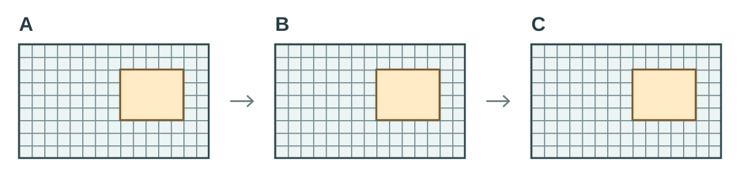
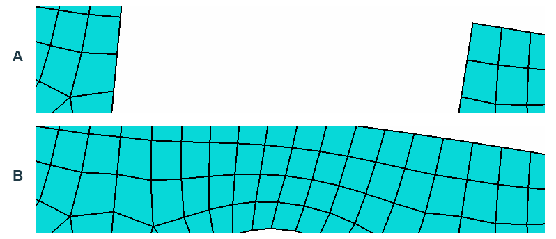
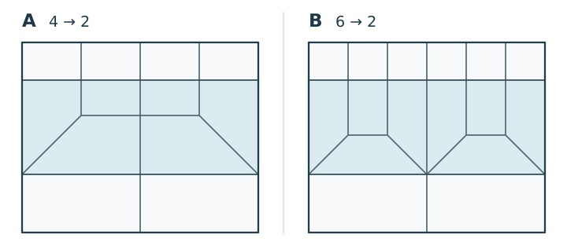
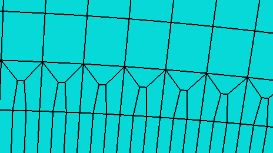
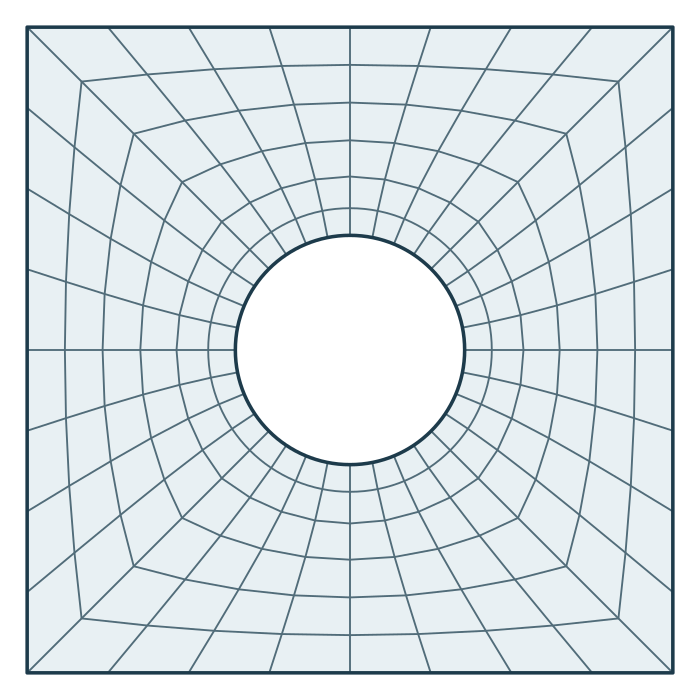
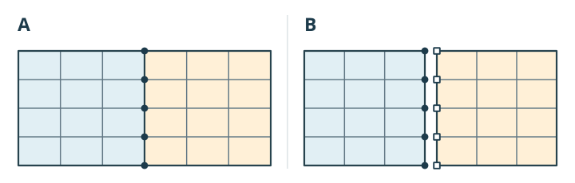

# abaqus_cae经验

## 第一部分：通用网格操作步骤

先确定网格要回答的力学问题。同一个带孔平板，用于求整体伸长量和用于求孔边应力时，值得加密的位置不同，对结果是否稳定的判断也不同。

### 1. 写下目标和验收条件

明确要观察的量、位置、工况和允许误差。确认几何表示、单位、材料、坐标系以及允许变动的区域。已有网格时，保留基准，在副本上试改；先写下哪些物理边界、界面或选区必须保持。单元数可以是成本约束，不能单独充当精度指标。

### 2. 弄清几何、载荷路径和旧网格的作用

沿着载荷从施加处到支承处查看模型，区分外形、材料分界、接触面和仅用于划网的内部分区。在改一个小面之前，查谁在使用它：截面、边界条件、载荷、接触或输出。复用已有分区或脚本时，核对其坐标系、逻辑边链、源面和目标面，再比较分段在空间里的实际位置。相同的段数可能对应不同的节点分布。

### 3. 选能回答问题的试验范围

要比较划分技术，可以先取简单区域；要判断能否接回整件，试验就要带上相邻区域及其约束。包含重复特征时，至少察看一个普通位置和条件不同的位置，例如靠自由边的孔。单独区域能生成，说明这个局部可行；扩大范围后，还要检查原来没有包含的接口。

### 4. 一起选择单元、分区和划分技术

根据厚度、弯曲、接触和所需输出选择几何表示与单元。有规则对应边界的区域可评估 Structured；有明确源面、目标面和路径的区域可评估 Sweep；其余区域按实际拓扑选择合适的自由划分或必要分区。新增分区前，说清它是为了控制尺寸、方向还是连接。截面上看得到一条分区线，并不能证明切分已经贯穿预期厚度。

### 5. 按整条边链布种

把共用同一边界的区域放在一起设计。一个逻辑边可能被 CAD 拆成几段：既要核对整条链的分段，也要核对各段长度、细端位置和偏置方向。生成后对实际单元边重新计数，查看相邻边长怎样变化。布种请求、实际得到的分段、网格线在空间里的排布，是三项不同的检查。

### 6. 生成候选，区分失败的类型

一次改变一个因素，或明确记录不可分开的组合。整体生成遇到问题时，可以先生成关键区域，再把必须协调的邻区作为一批接回。每批完成后复查前一批；新区域有单元，并不保证之前的网格仍然存在。把“没有生成单元”“生成完整但连接不对”“连接正确但形状差”分开记录，它们的排查方向不同。[反复补划仍有空块时的实录与排查方法](#过渡网格与反复缺块)

### 7. 对照几何检查覆盖、接口和物理选区

逐个检查应划网区域是否有单元，截面是否覆盖目标范围。应连续的区域按完整单元边或单元面核对连接；本应分开的接触面按接触定义验收。对命名集合和表面核对位置、范围、侧别及使用它的定义。集合非空只能证明选到了东西，不能证明选对了地方。

### 8. 同时看目标区和受影响的邻区

分别记录 Abaqus 网格质量检查的失败与警告、适用的形状指标、异常位置，以及关键物理边界的离散精度。不同判据可能命中同一单元，汇总数量时要去重。比较基准与候选时，把目标区、受改动影响的所有邻区和全模型并列：全局最坏值没变，有时只是因为它始终落在另一个区域。

### 9. 对齐输入检查和工程验证

核对实际输入里的单元、材料、截面、边界、连接、载荷和输出。判断目标响应是否对网格敏感，可在同一工况和取值口径下比较解，必要时对照解析解、试验或参考解。求解器收敛与网格细化后的响应趋于稳定，应分别记录。

### 10. 保存、重开，验证需要交付的内容

重新打开候选，核对关键选区、连接和网格仍在。若要交付可重复使用的划分方法，还要在另一份副本上重新生成；直接重开文件不能证明种子和分区会重建同样的布局。记录实际采用的控制、验证范围、失败反例及未做的检查，以便后来的人能判断是否适用。

## 第二部分：可迁移的局部案例

本部分先复盘一个反复出现的问题，再讲粗细网格怎样过渡。图注区分按记录绘制的示意图和实际网格裁图。后面的六个案例使用独立构造的教学几何。

### 过渡网格与反复缺块

#### 重点复盘｜反复补划，为什么总有一部分没有体网格？

一次三维过渡网格尝试中，大部分实体已经有了单元，过渡带端部仍留下一组空块。我把这些块按共享面分组，与相邻块联合生成，又做了允许网格器覆盖种子约束的对照。**每批都实际执行了生成，前后逐块对照，空的始终是同一组实体，没有新增填满的块。** 脚本执行到末尾，整件网格仍不完整。

*持续缺块、最终仍未划全的路线（状态示意）。A 是联合补划前，B 是联合补划后，C 是允许覆盖种子约束再试后。浅色块代表仍为零体元的那组实体。图形、格数和面积仅用于示意。*

这次复盘能确定试过哪些条件、哪些区域始终为空。要解释端部为何生成不了，当时还缺同条件下成功块与失败块的源面、目标面、侧面边链和已有邻面网格对照。我在相同条件的重试不再填入任何块时停下了这条路线。后来得到完整覆盖用的是另一套保留已有网格布局的方案。复用经验时，这两个结局要分别记录。

**下一次遇到同样的现象，可以按下面的顺序排查。**

1. **先判定哪里真的是空块。** 列出应划网的全部三维实体分区，读取各区拥有的三维体单元数。确认生成调用已经执行。只有二维面网格、生成前脚本因保护检查停下、体网格已生成但有质量警告，这三种状态各有不同的下一步。
2. **查缺块从哪一步出现。** 在改布种或控制前、改后尚未生成时、每批生成后，各存一份空块清单。对照哪些块刚填满、哪些邻块原本有网格现在变空、哪些块从头到尾都空。总数相等时尤其要比位置。若重分区改变了编号，用几何位置和邻接关系对回原区域。
3. **抓住一个持续为空的块做对照。** 读回源面与目标面的实际网格、侧面完整边链的分段及扫掠路径。将同一几何、种子和控制分别放在“保留实际邻面网格”和“释放邻面重新生成”的副本中比较。局部能生成而接回后失败时，优先查共享面；两边都空时，再查源面布种和路径。
4. **根据差异决定是否再试。** 同一组块持续为空，换顺序或重复同一调用又没有填入新块时，保存这份失败状态。下一次只改有证据指向的条件。得到网格后，复查目标、受影响邻区和完整共享面，再查质量。少算了空块会让总单元数显得更少，做减量比较前须先确认覆盖相同。

**另一条局部对照说明怎样找到有用的改动。** 一个目标块在整体生成、逐块生成以及与已有邻块联合补划时均为零体元。核对后发现，一条逻辑边由多段 CAD 短边组成。保留整条边的总分段数、扫掠路径和原算法，仅调整短边之间的分配，就在保留邻网格时生成了该块。这个结果支持检查**分段落在哪些短边上**，具体分配取决于当前几何。

*另一处单块恢复（实际网格裁图）。A 的中间区域在体单元清单里为零，两端已有网格。B 是调整短边分配后的同一位置，新增体单元经保存重开核对。两幅采用相同裁窗、比例和旋转方向。*

#### 从细区接到粗区的几种做法

下表的形式名称取自《ABAQUS 案例分析38 二维、三维过渡网格划分教程》的抽帧学习记录，布置和检查建议来自后续划网实践。记录中，方形局部细化集中在约第 37 至 64 分钟，二维圆环在约第 66 至 75 分钟，后段还有三维端面和圆柱侧面。读图时先沿细侧、粗侧两条对应边**数单元边段**，再跟踪中间的网格线怎样连接。逐排加宽单元可以改变间距。当两端要接入的列数也不同时，还需要在过渡带内安排连接。

|形式|怎样布置与检查|
|---|---|
|二合一、三合一|在两端选同一宽度，按细侧与粗侧的目标段数分组。下图 A 示意四段接两段，B 示意六段接两段。沿过渡单元逐边追踪，检查每个内部边都由相邻单元共用。|
|混合过渡|同一条边界上，各段需要减去的列数可能不同。可在不同段组合局部连接和普通网格列，再检查两组相接处是否共用同样的分点。|
|双层过渡|过渡区有足够宽度时，设置中间一排或一带，把列数变化分两次完成。先对齐中间交界处的分点，再看每层是否有足够空间让网格线转向。|
|方形区域四周过渡|先划定要保持分辨率的内方区，再在四周留过渡带。除四条直边外，单独看角部，两条边上的减列在这里相遇，最容易挤出尖角或狭长单元。|
|二维圆环过渡|在对应弧段上分别数内、外边界的周向段数，沿径向安排过渡。整圈检查闭合接缝，也要看各段实际弧长。弧长变长和周向列数减少是两个可以分别量测的变化。|
|三维端面与圆柱侧面|可扫掠体先在源端面排好细区、过渡带和粗区，再沿实际路径传递到目标端面。若过渡发生在圆柱侧面，可先按周向和轴向读它的展开布局，再检查接缝、另一端、厚度层和相邻体的连接。|

*教学示意，细侧在上、粗侧在下。A、B 都保留两端的常规网格行，便于直接数段。中部线条是单元边，示意的段数和连接仅对应图中构型。*

*后续独立划网试验的实际裁图。细侧在下、粗侧在上。沿中间一个完整的三合一单元组往上看，可以看见密列的网格线在带内转向，粗区重新排成规则列。*

在 Abaqus/CAE 里，先利用已有几何边界安排必要的过渡带，再设种子和适用的划分技术。只在需要单独控制某条边或某个区域时增加几何分区。看见网格线转向，不能据此判定每条斜线都要切成 CAD 边。教学模板里的成组或奇偶条件，要按所选模板的完整边界重新核对。选择 Structured 或 Sweep、设定边种子约束，以及在适用算法中允许映射划分，是不同设置。生成后仍按实际边段、面连接和逐块覆盖判断结果。[Abaqus 网格属性与控制](https://docs.software.vt.edu/abaqusv2025/English/SIMACAECAERefMap/simacae-c-mgnbasicsattributes.htm) · [边种子约束](https://docs.software.vt.edu/abaqusv2025/English/SIMACAECAERefMap/simacae-c-mgnconcseedconstraint.htm)

### 案例一｜方板上的圆孔：孔边细了，过渡也要看

设一块等厚方板，中间有一个光滑通孔，要观察面内拉伸时的孔边应力。可以在孔周留一圈便于控制的区域，使靠孔的单元边沿圆周排布，再向板面过渡。这样的分区是为了让孔边布种和离孔方向的间距可以分别调整，不意味着所有带孔零件都要画同一圈。

*图一　圆孔与方形外边界之间的一种网格连接示意。线条表示单元边，不要求在几何模型上逐线创建分区。*

在孔周取不同方向，量实际弦长和第一排单元的离孔尺寸；再找从细到粗变化最急的位置，看那里是否出现过长或过斜的单元。细化对照时，保持载荷、支承和应力的取值位置、平均方式一致。这样才有依据判断“孔边应力是否稳定”。如果孔贴近自由边，环形区本身可能形成窄片，应先重新选择分区边界。

### 案例二｜板内的一条分界：线重合，节点是否共用？

把一个连续板域分成左右两区，仅为了分别控制网格。图 A 的界线上相邻单元使用同一组节点。图 B 中两区各有自己的节点；即使把两条边放回同一坐标，又给它们相同的分段数，几何上重合的节点也不会因此自动变成同一节点。

*图二　A 的一列实心圆表示两区共用的节点。B 的实心圆和空心方框分别属于两区；两列刻意错开，便于看清各自节点，不表示真实间隙。*

在同一网格内，分别提取界线两侧单元实际使用的完整边，比对节点标识和相邻连接；高阶单元还要包含边中节点。装配里先确认节点属于哪个实例：两个实例可以各自有相同的节点编号。三维模型对应检查整张界面上的完整单元面。只比坐标或只查一个点，都分不清 A 与 B。若本来就是允许分离或滑移的两块板，两侧独立网格可以是正确设计，此时应检查接触双方、法向与允许的运动。

### 案例三｜矩形条上的偏置：两端计数相同，中间仍然斜

为了在矩形条的一端加密，给两条相对长边相同的分段数。若两条边各自的起点不同，使用相同的偏置设置可能让细端落在相反的物理位置。只查两个整数发现不了这个问题。

选定同一个物理端作为起点，沿两条边依次记录节点到该端的累计距离，再除以各自边长。比较同序分点的位置和相邻间距，检查跨条宽的网格线是否符合预期。若细端相反，先纠正方向，再决定是否增加种子。遇到刻意设计的非均匀间距，应与目标分布比较，而非强求所有边等分。

### 案例四｜截面能扫掠，接回邻区后却缺了一块

设一个直棱柱与邻块相接。单独划棱柱时，源面可由划分器自由生成；放回邻块后，共享面已有的面网格可能约束它。先在副本中保持原控制和种子，只比较“保留邻面网格”和“允许共同重新生成”这两个条件。记录源面实际布局、通往另一端的边，以及各实体是否都有体单元。

若两种条件给出不同结果，它说明邻面状态值得进一步排查，并不能单凭这一次对照就确定唯一原因。若两种都能生成，还要检查内部连接：外边界的分段相同，面内四边形的连法也可能不同。此例的终点是找出可重复的触发条件，再检验完整零件。

### 案例五｜移动一个节点：哪一侧付出了代价？

一条过渡带里有一个斜单元。看起来在零件内部的节点也可能落在材料界面上，或被某个约束引用。先确认它能否移动、能沿哪些方向移动，再列出所有使用该节点的单元。在两份副本上比较改前、改后的面角、长宽比、原生质量结果和受保护边界的位置。节点附近属于另一区域的单元也要纳入比较。

原斜单元改善且总警告数下降，仍可能伴随邻区产生新的狭长单元。接受与否取决于预先约定的局部精度和允许代价。若最坏单元的位置变了，应给出新位置；若边界离散也变了，还要在相同工况下复核响应。回到基准时，从冻结副本复原，比反向拖动节点更容易判定是否真的还原了。

### 案例六｜分区后的支承面：集合还在，施力位置可能已变

设矩形试片的一端受约束，另一端施加面力。为了局部加密，将加载端面切成两个子面。脚本若仍按旧面号建集合，得到的集合可能非空，却只覆盖一半端面，甚至落在侧壁上。先在图上标明“整个加载端面”，再以位置、法向、面积和邻接关系找回对应子面。

重新核对实际被载荷引用的表面、载荷类型和方向。如果指定的是给定面力，加载面积改变会影响合力；如果指定的是总合力，同样的总量也可能施加在错误位置。导出后核对输入里的引用，按任务需要再用反力或位移作独立检查。这个例子的验收条件是物理定义仍作用在预期边界，而不仅是几何可以重新划网。
